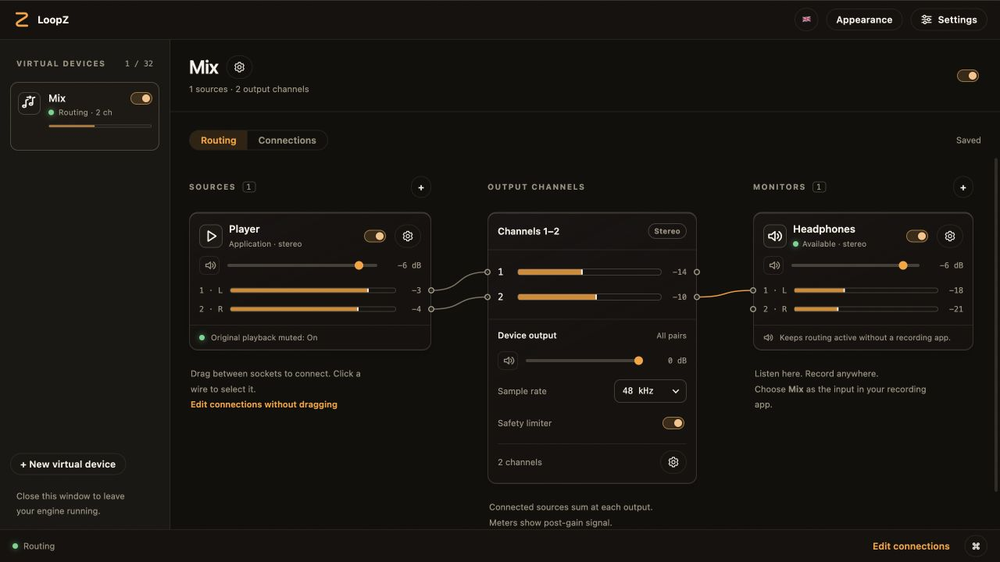

<p align="center"></p>

# LoopZ

[](https://github.com/lexasoft123/LoopZ/releases)
[](https://github.com/lexasoft123/LoopZ/actions/workflows/checks.yml)
[](https://github.com/lexasoft123/LoopZ/actions/workflows/core.yml)

**Low-latency virtual audio routing for macOS.** Combine microphones, audio
interfaces and sound from individual apps into your own virtual audio device.
Use the mix in Zoom, a recorder or your streaming software, and listen through
headphones or speakers.

- **Small hardware buffers** — 32- and 64-frame settings on compatible devices,
  with one persistent control for all inputs and monitors used by your mix.
- **Flexible multichannel mixes** — connect individual source channels to virtual
  outputs, with gain, mute, live meters and a safety limiter.
- **Background routing and recovery** — close the window and keep your mix
  running; saved connections are retained when a source or monitor disconnects.
- **Native audio setup** — install, update and repair audio components inside
  the app, with ordinary app updates separate from driver maintenance.



Built with **zCore**, **zdsp** and **singz-ui**. Audio runs locally in a
native background Engine; closing the window leaves your routing running.

## Low latency

Choose a smaller hardware buffer for responsive monitoring and recording, or a
larger one for more processing headroom. LoopZ applies your choice to all used
hardware inputs and monitors and remembers it across reconnects.

At 48 kHz, the duration of **one hardware buffer** is:

| Buffer size | Duration |
| --- | --- |
| 32 frames | 0.67 ms |
| 64 frames | 1.33 ms |
| 128 frames | 2.67 ms |
| 256 frames | 5.33 ms |

These durations are not the complete microphone-to-speaker delay. The full path
also includes device conversion, capture and routing buffers, clock alignment,
monitoring and the receiving app. Results depend on your hardware and mix;
very small buffers need more CPU headroom.

For hardware inputs, the Engine processes connected channels while taking
source-meter readings directly from capture callbacks, so unconnected hardware
channels keep their meters without being resampled for the mix.
Hardware-property checks run on the control thread rather than audio callbacks.

See [latency measurements and test conditions](docs/latency-comparison.md) for
measured paths, comparisons and remaining validation limits.

## Download and use

Download a DMG from [GitHub Releases](https://github.com/lexasoft123/LoopZ/releases).
The first release targets **Apple Silicon, macOS 14.2 or newer**. Windows and
Linux can build the portable core; desktop audio backends for those platforms
are future work.

1. Drag **LoopZ** from the DMG into **Applications** and open it.
2. On a fresh installation, open **Settings → Install audio components** and
   authorize macOS once. The signed driver and background service are installed
   separately from the desktop app.
3. Allow microphone access to capture physical inputs, and macOS audio-recording
   access to capture apps, when requested.
4. Create a virtual device, add sources, connect their channels to outputs, and
   choose **LoopZ: <your device name>** in your recording app.
   Add a monitor to hear it locally.

Users do **not** need Python, Node.js, Xcode or a separate installer package.
Use **Settings → Audio components** to install, update or repair the driver and
background service. Maintenance restores saved mixes and preserves audio defaults.
If macOS asks, allow LoopZ’s helper in **Login Items & Extensions**.
When first-time activation is needed, **Finish audio setup** briefly interrupts
audio in other apps while preserving your audio selections and saved mixes.

New to LoopZ? Choose **Take a tour** on the welcome prompt or in Settings for a
guided introduction to devices, sources, channel connections and monitors.
Pass-through sources also include **What is Pass-through?** help with an example.

## What it does

- **Virtual devices** — independent mixes with up to 64 channels, per-device
  on/off controls, gain, mute and a safety limiter.
- **App and hardware sources** — capture selected applications, microphones and
  multichannel interfaces; route individual channels into the mix.
- **Pass-through** — receive audio from apps that select your LoopZ device as
  their speaker/output. Combine that audio with other sources in the same mix.
- **Three-column routing** — sources → output channels → monitors. Drag between
  sockets, or use the Connections view and keyboard controls.
- **Monitoring** — send a mix to physical output channels while exposing it to
  other applications as a recording device. Monitoring is optional: recording
  apps can receive the mix even when no headphones or speakers are connected.
- **Saved routing and recovery** — retain connections when devices or apps
  disconnect and retry the desired graph automatically.
- **Live meters** — separate source and output levels, with visual interpolation
  between Engine readings.
- **One hardware buffer setting** — applied immediately to all used hardware
  inputs and monitors, with a target duration shown beside each size. The setting
  persists across reconnects. Smaller buffers increase CPU demand and can affect
  other applications using the same hardware.
- **Languages and appearance** — English, Russian and Simplified Chinese controls,
  a system-language option, and the SingZ light/dark palettes. Some diagnostic
  messages currently remain in English.
- **Guided first steps** — an interactive tour with a demo mix explains sources,
  output channels, monitors and using your virtual device in another app.
- **Update checks** — automatic checks every six hours, with a manual check in
  Settings. Like SingZ on macOS, updates open the release download page;
  installation is explicit. Driver installation is a separate action.

## Preview limitations

The first release is a preview. Very small hardware buffers are not yet a
universal glitch-free setting: recent live checks found remaining missing source
frames. The latency shown in Settings describes **one hardware buffer**, not the
complete microphone-to-speaker delay. See [measured latency](docs/latency-comparison.md)
for the actual experiments and their limits.

Fresh-install acceptance and application compatibility checks are tracked in
[the roadmap](docs/product-roadmap.md). The repository's tests do not by themselves
prove a clean-Mac installation or every third-party recording app.

## Develop

Requires CMake 3.24+, a C++20 compiler, Python 3, Node.js, and Xcode 26 or newer on macOS.
zCore is a pinned Git submodule and SingZ UI is a pinned package; sibling
checkouts are not required. Initialize the submodule before configuring:

```sh
git submodule update --init --recursive
```

```sh
npm ci --ignore-scripts --prefix interface
cmake -S . -B build/release -DCMAKE_BUILD_TYPE=Release
cmake --build build/release --parallel 4
ctest --test-dir build/release --output-on-failure
npm test --prefix interface
```

Build the portable core on macOS, Windows or Linux:

```sh
cmake -S . -B build/core -DLOOPZ_BUILD_MACOS_BACKEND=OFF -DCMAKE_BUILD_TYPE=Release
cmake --build build/core --config Release --parallel 4
ctest --test-dir build/core -C Release --output-on-failure
```

Native code lives in `native/core` and `native/platform/macos`; the React interface
lives in `interface`. Build and release scripts use Python **on the development
machine and CI runner only**. Native formatting uses clang-format and Black;
frontend formatting uses the locked Prettier version.

Development workflow, worktree isolation, review requirements and audio-testing
rules are documented in [AGENTS.md](AGENTS.md).

## Releases

Like SingZ, releases are made from `v*` tags with versioned notes committed first.
CI builds and tests the app. Releases are currently signed locally through a
disposable keychain, submitted to Apple, stapled, and published with checksums.
Hosted signing is optional and disabled by default; see
[release setup](docs/releasing.md). Forks can run checks without Apple credentials.

[Architecture](docs/architecture.md) · [Installation and migration](docs/install.md) ·
[Editor contract](docs/editor-control.md) · [Validation](docs/validation.md) ·
[Report a bug](https://github.com/lexasoft123/LoopZ/issues)

## Credits and licensing

LoopZ uses pinned zCore audio/DSP sources and the MIT-licensed singz-ui package.
The zCore repository URL is recorded in `.gitmodules`, and its pin is the
`vendor/zcore` gitlink. UI package provenance remains in
`interface/packages/provenance.json`. Apple's driver sample notice remains in
[native/platform/macos/driver/APPLE-LICENSE.txt](native/platform/macos/driver/APPLE-LICENSE.txt).
BlackHole was studied as a timing and installation reference; its GPL implementation
is not included. No additional license for LoopZ's own source is granted in this
preview; copyright remains with its author.
