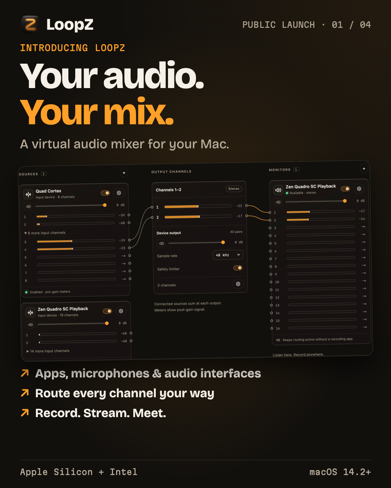

# LoopZ v0.2.3 — public launch

An introduction to the whole app, rather than an update changelog. The local
post kit contains four 4:5 images, photo captions and longer launch posts.
The kit is not bundled into the app and does not post to any channel.



## English photo caption

```text
Introducing LoopZ 🎛️
Your audio. Your mix.

Combine sound from apps, microphones and audio interfaces into a virtual microphone for Zoom, recording or streaming.

• Independent mixes with up to 64 channels
• App capture, hardware inputs and Pass-through
• Drag-to-connect routing, gain, mute, live meters and a safety limiter
• Optional headphone/speaker monitoring
• One saved buffer setting for all used hardware; 32/64-frame options on compatible devices
• Background routing, saved mixes and automatic reconnects; quiet when everything is off
• In-app audio setup and repair, update checks, dark/light themes, EN/RU/中文 and a guided demo tour

macOS 14.2+ · Apple Silicon + Intel
Small buffers are not total end-to-end latency.

Download: https://github.com/lexasoft123/LoopZ/releases/tag/v0.2.3
```

## Russian photo caption

```text
Знакомьтесь: LoopZ 🎛️
Ваш звук. Ваш микс.

Объединяйте звук приложений, микрофонов и аудиоинтерфейсов в виртуальный микрофон для Zoom, записи и стримов.

• Независимые миксы, до 64 каналов
• Звук приложений, физические входы и Pass-through
• Соединения мышью, громкость, mute, индикаторы и лимитер
• Прослушивание в наушниках или колонках
• Общая настройка буфера для всего используемого оборудования; 32/64 отсчёта на совместимых устройствах
• Работа в фоне, сохранённые миксы и восстановление подключений; минимум работы при выключенных миксах
• Установка и восстановление аудиокомпонентов в приложении, проверка обновлений, тёмная/светлая темы, EN/RU/中文 и интерактивный тур

macOS 14.2+ · Apple Silicon + Intel
Размер буфера — не полная задержка звука.

Скачать: https://github.com/lexasoft123/LoopZ/releases/tag/v0.2.3
```

## Full feature overview — English

Introducing LoopZ — your audio, your mix.

A virtual audio mixer for macOS. Combine apps, microphones and audio interfaces into a virtual microphone for calls, recording and streaming.

Virtual devices
Create independent mixes with up to 64 output channels. Turn a whole device on or off.

App + hardware audio
Capture individual apps, microphones and multichannel audio interfaces.

Pass-through
Receive sound from an app that selects your LoopZ device as its speaker or output.

Channel routing
Connect sources → outputs → monitors by dragging between sockets, or use the Connections view and keyboard controls.

Mix controls
Control gain and mute, watch source/output meters, and enable a safety limiter.

Optional monitoring
Send your mix to selected physical output channels. Other apps can receive it without a monitor.

Low-buffer settings
One setting applies to all used hardware inputs and monitors and persists across reconnects. 32/64-frame options depend on hardware.

Background routing
Close the window and keep routing. Choose startup at login in Settings. Disabled mixes stop audio processing.

Saved mixes + recovery
Retain your connections and retry unavailable apps, inputs and monitors automatically.

Native setup + repair
Install, update and repair the driver and service inside LoopZ. No Python, Node or developer scripts needed.

Update checks
Automatic checks every six hours and a manual check in Settings. Updates open the release page for explicit installation.

Appearance + languages
Dark and light palettes; English, Russian, Simplified Chinese and system-language selection. Some diagnostics remain in English.

Guided first steps
An interactive whole-app tour uses a demo mix; Pass-through has its own explanation.

Apple Silicon + Intel · macOS 14.2 or newer. Signed and notarized macOS DMGs.

Small hardware buffers are not total microphone-to-speaker latency. Results depend on your devices, routing and system load. Initial audio setup needs macOS authorization and may briefly interrupt sound to activate the driver. App/hardware capture needs the relevant macOS permissions.

Download: https://github.com/lexasoft123/LoopZ/releases/tag/v0.2.3

## Все возможности — русский

Знакомьтесь: LoopZ — ваш звук, ваш микс.

Виртуальный аудиомикшер для macOS. Объединяйте приложения, микрофоны и аудиоинтерфейсы в виртуальный микрофон для звонков, записи и стримов.

Виртуальные устройства
Независимые миксы: до 64 выходных каналов, отдельный выключатель каждого устройства.

Приложения и оборудование
Захватывайте звук отдельных приложений, микрофонов и многоканальных аудиоинтерфейсов.

Pass-through
Принимайте звук приложения, выбравшего устройство LoopZ своим выходом или динамиками.

Маршрутизация каналов
Соединяйте источники → выходы → мониторы мышью или используйте список Connections и клавиатуру.

Управление миксом
Регулируйте громкость, отключайте звук, следите за входными и выходными индикаторами, включайте защитный лимитер.

Прослушивание по желанию
Направляйте микс на выбранные физические выходы. Другие приложения получают его и без монитора.

Небольшие буферы
Одна настройка для всех используемых физических входов и мониторов. Выбор сохраняется; поддержка 32/64 отсчётов зависит от оборудования.

Работа в фоне
Закрывайте окно, сохраняя маршрутизацию. Автозапуск настраивается в Settings. Выключенные миксы не обрабатывают звук.

Миксы и восстановление
Сохранённые соединения восстанавливаются автоматически при возвращении приложений, входов и мониторов.

Установка и восстановление
Устанавливайте, обновляйте и восстанавливайте драйвер и службу внутри LoopZ — без Python, Node и скриптов разработчика.

Проверка обновлений
Автоматическая проверка раз в шесть часов и ручная в Settings. Для установки открывается страница выпуска.

Темы и языки
Тёмные и светлые палитры; английский, русский, упрощённый китайский и язык системы. Часть диагностики остаётся на английском.

Первое знакомство
Интерактивный тур по приложению с демонстрационным миксом и отдельная справка о Pass-through.

Apple Silicon + Intel · macOS 14.2 и новее. Подписанные и нотарифицированные DMG для macOS.

Буфер — не полная задержка от микрофона до колонок: она зависит от устройств, схемы и нагрузки. Первая настройка требует авторизации macOS; активация драйвера может ненадолго прервать звук. Захват приложений и физических входов требует соответствующих разрешений macOS.

Скачать: https://github.com/lexasoft123/LoopZ/releases/tag/v0.2.3
